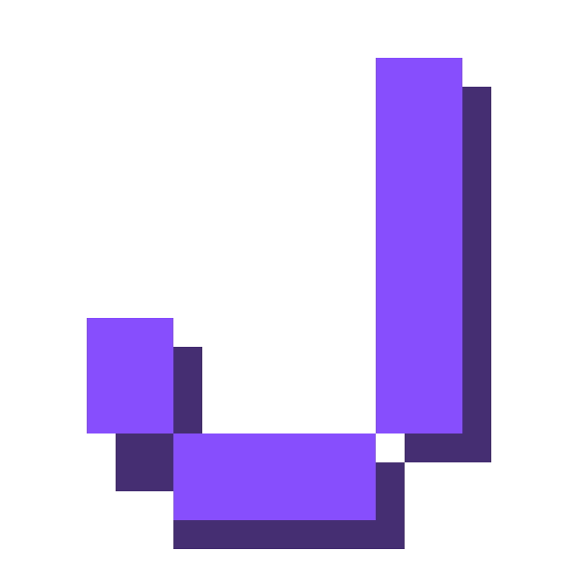

# RuCode Chat

RuCode Chat is a macOS fork of [Enchanted](https://github.com/gluonfield/enchanted) that talks to the
OpenCodeRust engine through its Bun control plane instead of a cloud LLM API. The SwiftUI interface,
the Apache-2.0 license, and the original attribution are retained.

The app is built for one stack: Bun control on `127.0.0.1:5656` and the Rust child engine on
`127.0.0.1:4096`. Nothing leaves the machine unless you point the URLs at a remote host.

## How it works

- `RuCodeAPI` is the only transport layer. It calls Bun control for models, sessions, prompts,
  the SSE event feed, agent status, schedules, and agent photos.
- Session deletion goes directly to the Rust engine (`DELETE /session/{id}`), because Bun control
  does not proxy that route yet.
- Bun control proxies sessions and the event stream to the Rust child. The app never talks to a
  provider directly.
- Tokens are stored in the macOS Keychain under service `com.vakandi.rucode-chat`, account
  `elia-auth-token`.
- Conversations, models, and completion instructions are persisted as a single JSON snapshot at
  `~/Library/Application Support/RuCodeChat/store.json`. SwiftData is not used by this build.
- Streaming consumes the Rust diff frames (`message.part.updated` and `message.part.delta`),
  deduplicates the first snapshot against the following delta, reconnects up to three times
  without re-sending the prompt, then reconciles the turn with the stored transcript.
- Provider failures arrive as assistant text prefixed with `Provider error:` and are surfaced as
  an error state instead of being reported as a successful turn.

## Features

- Streaming responses from the Rust engine, with reconnect and transcript reconciliation
- Bun model selection and Rust agent selection
- Conversation history, stored locally and discovered from existing Rust sessions
- Sidebar management: pin sessions to the top, group them into collapsible folders created with
  the folder button, and delete a session locally and on the Rust engine
- Markdown rendering with code highlighting, plus light and dark appearance
- File attachments: the paperclip inserts a coloured chip in the input, dragging any file anywhere
  on the chat also attaches it, hovering shows the full path, and the absolute path is prepended to
  the prompt when the message is sent
- Editable prompt templates on the empty chat screen: the pencil on a card edits it in place, and
  Settings can add, delete, reorder, and edit templates in a scrollable list. Long prompts are kept
  in full and truncated only for card display
- Agent management: enable or disable configured subworkers, edit their schedule (hourly,
  frequent, or cron, with day and hour selection), and upload or remove profile photos
- Bun control health and Rust child restart controls in Settings
- Native macOS app bundle, ad-hoc signed, no App Store dependency

## Requirements

- macOS 14 or newer
- Command Line Tools with Swift 5.9 or newer (`xcode-select --install`)
- A running Bun control plane and OpenCodeRust child. The local `subworker-opencode-rust`
  repository provides both, and seeds `ELIA_AUTH_TOKEN` in its `.env`.
- The token from that `.env`, either seeded in the Keychain or typed in Settings.

Xcode is not required. The SwiftPM manifest, `scripts/stage-sources.py`, and
`scripts/patch-deps.py` build the macOS sources without the Xcode-only macro plugins.

## Build and install

```bash
cd ~/Documents/rucode-chat
./scripts/build-app.sh
pkill -f "RuCode Chat.app/Contents/MacOS/RuCodeChat" 2>/dev/null || true
rm -rf "/Applications/RuCode Chat.app"
cp -R "dist/RuCode Chat.app" /Applications/
open "/Applications/RuCode Chat.app"
```

`build-app.sh` stages the macOS sources into `build/generated-sources/RuCodeChat`, strips
`#Preview` blocks, swaps SwiftData for the JSON store, patches dependency previews, builds with
SwiftPM in release mode, assembles the bundle, and signs it ad-hoc. Always edit the tracked
sources under `Enchanted/`, never the generated copy.

The build script clears `HTTP_PROXY`, `HTTPS_PROXY`, and related variables before invoking SwiftPM,
because a dead local proxy will otherwise block dependency resolution.

## First run

1. Start Bun control and the Rust child from the `subworker-opencode-rust` repository.
2. Open RuCode Chat, then Settings.
3. Confirm the Bun control URL (`http://127.0.0.1:5656`), the Rust engine URL
   (`http://127.0.0.1:4096`), and a server-visible working directory such as `~/Documents`.
4. Seed the token once if the Keychain entry is empty:

```bash
security add-generic-password \
  -s com.vakandi.rucode-chat \
  -a elia-auth-token \
  -w "$ELIA_AUTH_TOKEN" \
  -U
```

5. Pick a model from the toolbar. Sending without a selected model now shows an alert instead of
   failing silently.

## Configuration

Settings stores non-secret values in `UserDefaults`:

- `rucodeControlURL` defaults to `http://127.0.0.1:5656`
- `rucodeEngineURL` defaults to `http://127.0.0.1:4096`
- `rucodeWorkingDirectory` defaults to `~/Documents`
- `rucodeSelectedAgent` holds the selected Rust agent
- `rucodeSessionIDs` maps local conversations to Rust session IDs
- `rucodePromptTemplates` stores the empty-chat prompt templates as JSON
- `rucodePinnedConversations` stores the pinned conversation IDs
- `rucodeSessionFolders` stores the sidebar folders and their conversation IDs as JSON

The app relaxes App Transport Security (`NSAllowsArbitraryLoads`) so the localhost HTTP
endpoints work. Keep that in mind before pointing it at a remote control plane: use a reachable
HTTPS address and a matching token.

## Known limitations

- Stop generation is not available. The stop button was removed because the Rust prompt endpoint
  runs the turn to completion and its abort route has no effect. A turn keeps running server-side
  even if the window closes.
- Image prompts are rejected. The Rust integration is text-only, and the composer reports that
  images are unsupported if one is attached.
- Voice input, read-aloud, and the per-conversation system prompt were removed from this fork.
- Subagent and todo panels are not implemented. The Rust engine currently runs `task` subagents
  in an in-memory map without registering them as child sessions or emitting their tokens, so the
  client has no subagent events to render. This needs server-side work first.
- Deleting a session requires the Rust engine to be reachable. If the delete request fails, the
  local entry is removed but the session can reappear on the next refresh.
- The fork builds macOS only. The upstream iOS and visionOS targets are not part of the SwiftPM
  build.
- The app is ad-hoc signed. macOS may ask for confirmation the first time it is opened on another
  machine.

## Upstream

RuCode Chat is a derivative work of Enchanted by Augustinas Malinauskas. The upstream project and
its documentation describe the original app, not this integration. Changes made here are limited
to the transport, persistence, build pipeline, and the interface adjustments listed above.

- Upstream: https://github.com/gluonfield/enchanted
- License: Apache License 2.0, see [LICENSE](./LICENSE)

## Author

Augustinas Malinauskas (original Enchanted author)
